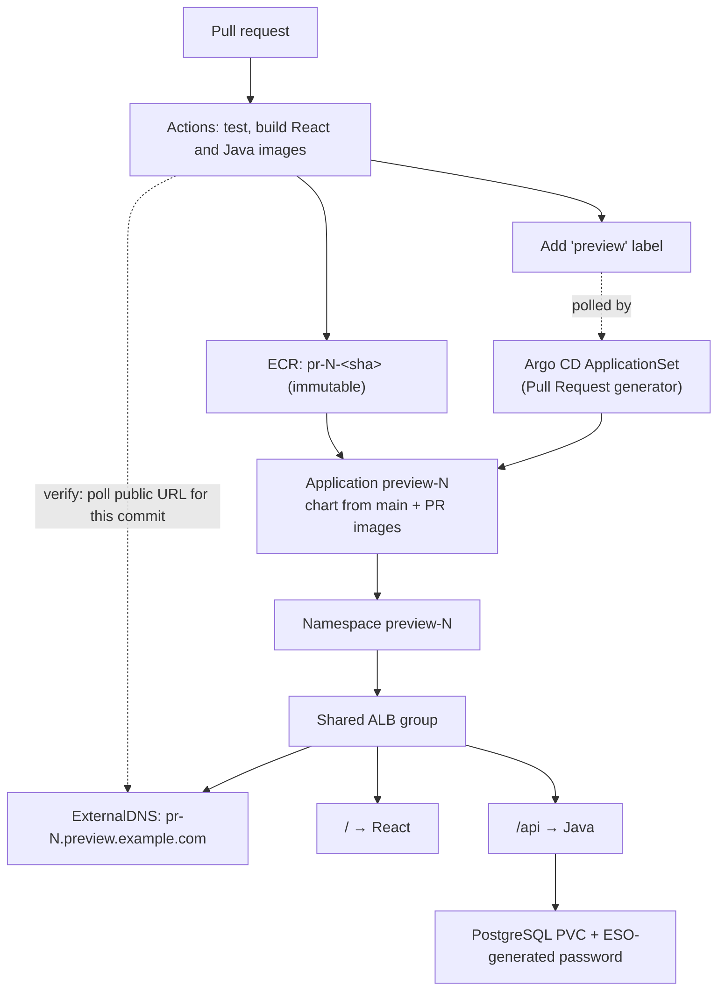
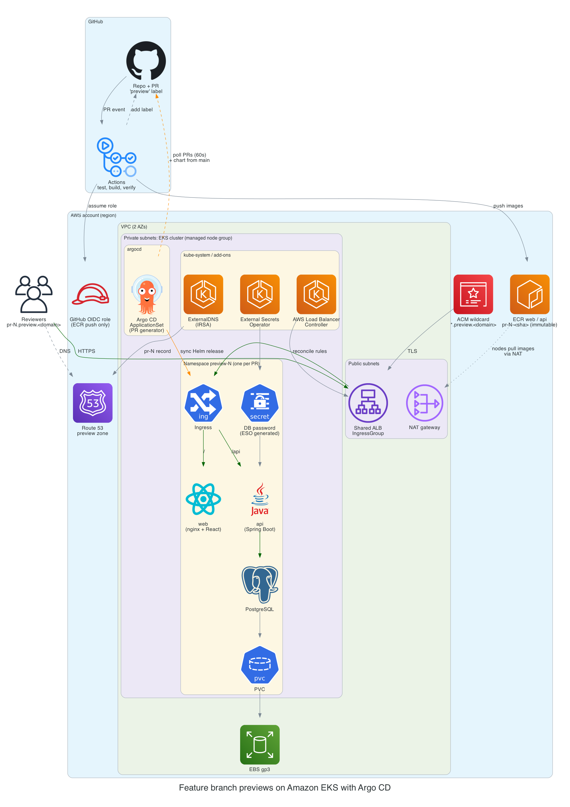

# Feature branch previews on Amazon EKS with GitOps (Argo CD) 

A small working example of ephemeral or preview environments for a React web app, Spring Boot Java API, and PostgreSQL. Each pull request from a branch **in this repository** gets its own copy at `https://pr-<number>.preview.example.com/`. 

The sample app page reads a counter from the database and can write to it. Pushing new commits updates the two app images without resetting the PR's database.

Deployment is **pull-based**. GitHub Actions only builds images and labels the PR. Argo CD runs inside the cluster, discovers labelled PRs with an ApplicationSet Pull Request generator, and syncs one Helm release per PR. When the PR closes, Argo CD deletes it. CI has no Kubernetes credentials at all.



### AWS deployment



## How it works

| Event | What happens |
| --- | --- |
| PR opened or pushed | `build` tests both apps and pushes `web` and `api` images tagged `pr-<N>-<head sha>`. `opt-in` adds the `preview` label. |
| Argo CD polls (every 60 s) | The ApplicationSet generates or updates the `preview-<N>` Application. The chart comes from the **default branch**, and the images are `pr-<N>-<head sha>`. Automated sync with `prune` and `selfHeal`. |
| Sync | Order: Namespace → `Password` generator and `ExternalSecret` (wave −1) → quota, PostgreSQL, API, web, Ingress. After everything is Healthy, a `PostSync` Job curls the public hostname and checks that it serves this commit. |
| `verify` job | Polls `https://pr-<N>.<domain>/api/visits` from the runner until `version` equals the PR's head SHA, then shows it as the PR's **View deployment** link. It uses no AWS or cluster access. |
| PR closed, or label removed | The generator stops producing the Application. Its `resources-finalizer` deletes all resources, including the Namespace, so the PVC goes too. ExternalDNS then removes the Route 53 record. |
| Drift or a missed event | Argo CD keeps reconciling continuously, so no cleanup or repair cron job is needed. |

Evidenced in [PR#1](https://github.com/upgundecha/preview-eks-demo/pull/1) and [PR#2](https://github.com/upgundecha/preview-eks-demo/pull/2)

## What it creates

| Layer | Implementation |
| --- | --- |
| Terraform `infra/cluster` (optional) | VPC (2 AZs, single NAT), dedicated **non-production** EKS cluster with access entries and IRSA, managed node group, EBS CSI add-on with a default gp3 StorageClass, AWS Load Balancer Controller |
| Existing | Public Route 53 hosted zone (or bring your own cluster instead of `infra/cluster`) |
| Terraform `infra/terraform` | ECR repositories (immutable tags), ACM wildcard certificate and DNS validation, GitHub OIDC role (**ECR push only**), ExternalDNS IRSA role |
| Cluster add-ons, once | ExternalDNS, External Secrets Operator, Argo CD, the `branch-previews` AppProject and ApplicationSet (`gitops/argocd/`) |
| Helm, once per PR (via Argo CD) | Namespace, quota, generated DB password, React Deployment and Service, Java Deployment and Service, PostgreSQL StatefulSet and PVC, ALB Ingress, PostSync smoke test |
| DNS and TLS | One shared ALB IngressGroup and ACM `*.preview.example.com` certificate; ExternalDNS creates and removes a Route 53 alias for each PR |
| GitHub Actions | Test, build and push; label the PR; verify the public URL. Nothing else. |

The `branch-previews` AppProject is the security boundary. It allows only this repository as a source, only `preview-*` namespaces as destinations, and only the resource kinds the chart uses. 

## Try the application locally

With Docker Compose installed:

```bash
docker compose up --build
```

Open <http://localhost:8080/>. Press **Record a visit**, refresh the page, and observe that PostgreSQL retains the counter. The local NGINX configuration proxies `/api` to the Java container. Run `docker compose down -v` to remove the local sample database.

## AWS prerequisites

1. Use GitHub.com or GitHub Enterprise Cloud, an AWS account, and `aws`, `terraform`, `kubectl`, `helm`, `envsubst` (from `gettext`) and `gh` locally. The example uses GitHub's public OIDC issuer; GitHub Enterprise Server needs its own issuer and trust configuration, plus the ApplicationSet's `github.api` field.
2. Use a **dedicated EKS cluster**. Either create one with step 0 below, or bring an existing one that meets these requirements:
   - an IAM OIDC provider for IRSA and access entries enabled (`API` or `API_AND_CONFIG_MAP`);
   - the [AWS Load Balancer Controller](https://docs.aws.amazon.com/eks/latest/userguide/lbc-helm.html) with its documented IAM permissions, on ordinary EKS networking rather than EKS Auto Mode;
   - a default dynamically provisioned StorageClass (`kubectl get storageclass`), typically the [EBS CSI driver](https://docs.aws.amazon.com/eks/latest/userguide/ebs-csi.html);
   - nodes that can pull from ECR, and public subnets tagged `kubernetes.io/role/elb=1` in at least two AZs;
   - **outbound** access to `api.github.com` and `github.com`, so Argo CD can poll PRs and clone the chart. The API endpoint can be private: only you (for the one-time bootstrap) and Argo CD (in-cluster) talk to it.
3. Use an **existing public Route 53 hosted zone** that contains `preview_domain`. `preview.example.com` may be its own delegated zone, or `example.com` may be the parent zone. The Terraform identity needs permission to create ECR, IAM, ACM and DNS validation records. Allow time for DNS and ACM validation before expecting PR previews.

This demo uses an **internet-facing** ALB and synthetic data. Keep real secrets, customer data and production endpoints out of these namespaces. To make previews internal, change `preview.scheme` to `internal` in `helm/preview/values.yaml` and use matching internal DNS and certificates. The in-cluster smoke test still works. The Actions `verify` job then needs a runner with VPC access, or you can remove it.

## 0. Create the VPC and EKS cluster (skip if you bring your own)

```bash
cp infra/cluster/terraform.tfvars.example infra/cluster/terraform.tfvars
# Set aws_region and cluster_name; narrow endpoint_public_access_cidrs to your IP.
terraform -chdir=infra/cluster init
terraform -chdir=infra/cluster apply          # ~15-20 minutes
$(terraform -chdir=infra/cluster output -raw configure_kubectl)
kubectl get nodes,storageclass
kubectl -n kube-system get deploy aws-load-balancer-controller
```

This creates the following:

- a VPC across two AZs, with tagged public and private subnets and one NAT gateway;
- an EKS cluster using access entries only, with the IAM OIDC provider and AL2023 managed nodes (2× `t3.large` by default);
- the `vpc-cni`, `kube-proxy`, `coredns` and `aws-ebs-csi-driver` add-ons. The EBS add-on creates the default gp3 StorageClass `ebs-csi-default-sc`;
- the AWS Load Balancer Controller, installed by Helm with an IRSA role.

The identity that runs `apply` gets cluster-admin through an access entry, which you need for the install scripts below. It runs continuously and incurs ongoing cost, mostly from the EKS control plane, the nodes and the NAT gateway. To remove it, use `scripts/nuke.sh` (see [Tear everything down](#tear-everything-down)) rather than a bare `terraform destroy`. The script removes the ALBs, DNS records, EBS volumes and ECR images created from inside the cluster first; a bare destroy would leave them behind or get blocked by them.

The state is local. For a shared setup, add a `backend "s3"` block to both stacks.

## 1. Provision the AWS pieces

```bash
cp infra/terraform/terraform.tfvars.example infra/terraform/terraform.tfvars
# Edit the copied values for your cluster, GitHub repository and Route 53 zone.
# eks_cluster_name / aws_region: the cluster_name / aws_region from step 0.
terraform -chdir=infra/terraform init
terraform -chdir=infra/terraform plan
terraform -chdir=infra/terraform apply
terraform -chdir=infra/terraform output
```

If an IAM GitHub OIDC provider already exists in your AWS account, supply its ARN as `github_oidc_provider_arn` instead of creating a second one.

**Check the repository's OIDC subject format first.** Run `gh api repos/OWNER/REPO/actions/oidc/customization/sub`. If it shows `"use_immutable_subject": true`, which is the default for new repositories, GitHub sends `repo:OWNER@OWNER_ID/REPO@REPO_ID:pull_request`. In that case, set `github_owner_id` (`gh api users/OWNER --jq .id`) and `github_repo_id` (`gh api repos/OWNER/REPO --jq .id`). Otherwise, `configure-aws-credentials` fails with *Not authorized to perform sts:AssumeRoleWithWebIdentity*. The trust policy matches these exact IDs and never uses wildcards. `route53_zone_id` must point to the **public** hosted zone used for ACM validation and preview aliases.

> **Upgrading from the push-based version?** `terraform apply` removes the GitHub role's EKS access entry and its cluster-admin association, and narrows its trust to PR jobs. Also delete the old `default_branch` line from your `terraform.tfvars`. Previews that the old workflow created with plain Helm are not managed by Argo CD. Remove them with `helm uninstall preview-<N> -n preview-<N> && kubectl delete ns preview-<N>`. Once the PR is labelled, Argo CD recreates them.

## 2. Install ExternalDNS

Configure local `kubectl` for the cluster (step 0 already did this if you used it). Export the parent zone's name, which is `example.com` when the zone contains `preview.example.com`:

```bash
export CLUSTER_NAME=my-dedicated-preview-cluster
export AWS_REGION=ap-southeast-1
export ROUTE53_ZONE_NAME=example.com
export ROUTE53_ZONE_ID=Z0123456789EXAMPLE
export EXTERNAL_DNS_ROLE_ARN="$(terraform -chdir=infra/terraform output -raw external_dns_role_arn)"
aws eks update-kubeconfig --name "$CLUSTER_NAME" --region "$AWS_REGION"
bash scripts/install-external-dns.sh
```

The script installs the official ExternalDNS Helm chart. It watches only Ingresses that carry this example's annotation, changes records only in the specified public zone, and uses TXT ownership records. Its `sync` policy removes a preview's DNS record when its Ingress disappears.

## 3. Bootstrap Argo CD

Push this repository's files to the **default branch first**. Argo CD renders every preview from the chart on that branch, so a PR can't change the templates that deploy it. To change the chart, merge the change to the default branch.

Create a fine-grained GitHub token limited to this repository, with **read-only** *Pull requests* and *Contents* access. Then run:

```bash
export GITHUB_OWNER=your-github-org
export GITHUB_REPO=preview-eks-demo
export GITHUB_TOKEN=github_pat_...            # read-only, this repo only
export DEFAULT_BRANCH=main
export PREVIEW_DOMAIN=preview.example.com
export ACM_CERTIFICATE_ARN="$(terraform -chdir=infra/terraform output -raw preview_certificate_arn)"
export WEB_ECR_URL="$(terraform -chdir=infra/terraform output -raw web_ecr_url)"
export API_ECR_URL="$(terraform -chdir=infra/terraform output -raw api_ecr_url)"
bash scripts/install-gitops.sh
```

The script installs pinned versions of External Secrets Operator (chart `2.14.0`) and Argo CD (chart `10.11.6`, Argo CD v3.5.6). Override them with `ESO_CHART_VERSION` and `ARGOCD_CHART_VERSION`. It stores the token as `argocd/github-token` and as a repository credential. It then fills the `${...}` placeholders in `gitops/argocd/*.yaml` and applies the AppProject and ApplicationSet. Re-run it after changing those files, or after rotating the token.

Argo CD polls GitHub every 60 seconds. For near-instant pickup, expose the ApplicationSet controller's webhook and add a GitHub *Pull request* webhook. See [ApplicationSet webhooks](https://argo-cd.readthedocs.io/en/stable/operator-manual/applicationset/Generators-Pull-Request/#webhook-configuration).

## 4. Configure GitHub Actions variables

Set these **repository variables** under Settings → Secrets and variables → Actions → Variables:

| Variable | Value |
| --- | --- |
| `AWS_REGION` | Terraform's `aws_region`, e.g. `ap-southeast-1` |
| `GH_ROLE_ARN` | Terraform output `github_role_arn` |
| `WEB_ECR_URL` | Terraform output `web_ecr_url` |
| `API_ECR_URL` | Terraform output `api_ecr_url` |
| `PREVIEW_DOMAIN` | Terraform's `preview_domain`, e.g. `preview.example.com` |

The workflow uses no static AWS key and no cluster credentials. GitHub OIDC issues short-lived credentials that can only push to the two ECR repositories, and only from this repository's `pull_request` jobs.

## 5. Open a feature PR

Change the React headline or Java API in a feature branch, push it, and open a pull request. `Feature branch preview` builds the images and adds the `preview` label (creating it the first time). Within about a minute, Argo CD creates the `preview-<N>` Application. The `verify` job finishes once `https://pr-<N>.<PREVIEW_DOMAIN>/` serves that commit (the page footer shows the short SHA), and it publishes the URL as the PR's **View deployment** link.

Each later push builds `pr-<N>-<new sha>`, and the ApplicationSet updates the image references. The Namespace, generated DB password and PostgreSQL PVC are kept. To remove a preview while the PR stays open, remove the `preview` label. Closing the PR removes it too.

Fork PRs are not built, because forks can't assume the AWS role. If a maintainer labels a fork PR anyway, Argo CD creates an Application whose pods can't pull images. That is harmless, because the chart still comes from the default branch and stays inside the AppProject's limits. Remove the label to clean it up.

### Useful diagnosis commands

```bash
kubectl -n argocd get applicationset branch-previews -o jsonpath='{.status.conditions}'
kubectl -n argocd get applications -l preview-demo.example.com/pr
kubectl -n argocd describe application preview-184
kubectl -n preview-184 get pods,svc,ingress,pvc,externalsecret,job
kubectl -n preview-184 logs job/preview-smoke-test
kubectl -n preview-184 logs deploy/preview-api --tail=100
kubectl -n external-dns logs deploy/external-dns --tail=100
curl -fsS https://pr-184.preview.example.com/api/visits
```

Replace `184` and the domain with your PR. Each symptom points at a different component:

| Symptom | Where to look |
| --- | --- |
| No Application appears | ApplicationSet conditions: token, label, rate limit |
| Application `OutOfSync` with a permission error | AppProject whitelist |
| Ingress stuck `Progressing` | AWS Load Balancer Controller logs |
| ALB exists but no alias | ExternalDNS and hosted-zone selection |
| Pods in `CreateContainerConfigError` | `ExternalSecret` status and External Secrets Operator logs |
| Smoke test failing | API logs and database PVC |

Argo CD UI: `kubectl -n argocd port-forward svc/argocd-server 8443:443`, then open <https://localhost:8443/>. The admin password is in the `argocd-initial-admin-secret` Secret.

## Tear everything down

```bash
export PREVIEW_DOMAIN=preview.example.com ROUTE53_ZONE_ID=Z0123456789EXAMPLE   # optional: verifies DNS cleanup
bash scripts/nuke.sh                  # asks you to type the cluster name
bash scripts/nuke.sh --keep-cluster   # everything except infra/cluster
```

The script removes everything in dependency order:

1. It deletes the ApplicationSet. Argo CD then deletes every preview namespace, while the Load Balancer Controller and ExternalDNS are still running to remove the ALB and the DNS records.
2. It uninstalls Argo CD, External Secrets Operator and ExternalDNS.
3. It deletes anything that was left behind:
   - the preview IngressGroup's ALB, target groups and security groups;
   - detached EBS volumes of `preview-*` PVCs that are tagged for this cluster. Volumes without a cluster tag are only listed, not deleted.
4. It empties the ECR repositories and runs `terraform destroy` in `infra/terraform`.
5. It runs `terraform destroy` in `infra/cluster`. This step is skipped with `--keep-cluster`, and when there is no `infra/cluster` state because you brought your own cluster.

The cluster name and region come from `infra/cluster`'s outputs. Set `CLUSTER_NAME` and `AWS_REGION` for a cluster you brought yourself. The script is safe to re-run after a partial failure. It doesn't touch GitHub, so revoke the Argo CD token and delete the `preview-*` environments yourself.

## Design boundaries

- **Trust boundary.** Only cluster admins should be able to change the ApplicationSet or AppProject. The ApplicationSet's `project` is fixed rather than templated from PR data, as the [Argo CD PR generator security notes](https://argo-cd.readthedocs.io/en/stable/operator-manual/applicationset/Security/) require. Anyone who can add the `preview` label can start a preview. They can't change what gets deployed beyond images CI built from this repository.
- **One PostgreSQL pod and PVC per PR.** This makes data isolation visible. It is a demo database, without backups or high availability. For many concurrent previews, use a shared non-production database cluster with a database and user per PR, or a managed cloning approach.
- **DB password.** External Secrets Operator generates the password with `refreshPolicy: CreatedOnce` and an immutable target Secret, so it is never rotated underneath the existing volume. It isn't stored in Git or in CI. If you delete the `ExternalSecret` by hand, the namespace's database can no longer be reached with the new credentials. Remove the label to recreate the preview.
- **Shared ALB IngressGroup.** All previews share one IngressGroup. Only the trusted chart on the default branch creates Ingresses in that group, and the AWS controller warns that an Ingress author could otherwise add or override group rules. Check ALB listener-rule capacity before allowing many simultaneous PRs.
- **Image tags.** Tags are `pr-<N>-<sha>` and immutable, so re-running a workflow for the same commit reuses the existing images. ECR images accumulate until you add a lifecycle policy suited to the longest-lived preview.
- **Volume cleanup.** Deleting the namespace deletes the PVC. Whether the underlying EBS volume is also removed depends on your StorageClass reclaim policy, so check it.
- **DNS caching on new hostnames.** The smoke test usually looks up `pr-<N>` before ExternalDNS has created it. The VPC resolver then caches that "doesn't exist" answer for the smaller of the zone's SOA TTL and its SOA minimum field. For a new Route 53 zone that is 900 seconds, so the first preview took about 5 minutes longer than it needed to. Lower it once per zone:

  ```bash
  Z=<zone-id>
  soa=$(aws route53 list-resource-record-sets --hosted-zone-id $Z --query "ResourceRecordSets[?Type=='SOA']|[0]" --output json)
  v=$(jq -r '.ResourceRecords[0].Value' <<<"$soa" | awk '{$7=60; print}')
  aws route53 change-resource-record-sets --hosted-zone-id $Z --change-batch "$(jq -n --arg n "$(jq -r .Name <<<"$soa")" --arg v "$v" \
    '{Changes:[{Action:"UPSERT",ResourceRecordSet:{Name:$n,Type:"SOA",TTL:60,ResourceRecords:[{Value:$v}]}}]}')"
  ```

  The smoke test and the `verify` job still allow 20–25 minutes, in case your zone isn't changed.
- **Alternative layout.** If you want every deployment recorded as a Git commit, for example so you can pin by digest, have CI write `previews/pr-<N>/values.yaml` to a separate config repository. Then switch the ApplicationSet to a Git directory generator. CI then needs write access to that repository, and a closed PR must delete its folder.

## Source documentation

- [Argo CD ApplicationSet Pull Request generator](https://argo-cd.readthedocs.io/en/stable/operator-manual/applicationset/Generators-Pull-Request/)
- [Argo CD resource hooks](https://argo-cd.readthedocs.io/en/stable/user-guide/resource_hooks/) and [sync waves](https://argo-cd.readthedocs.io/en/stable/user-guide/sync-waves/)
- [External Secrets Operator Password generator](https://external-secrets.io/latest/api/generator/password/)
- [AWS Load Balancer Controller Ingress annotations and IngressGroups](https://kubernetes-sigs.github.io/aws-load-balancer-controller/latest/guide/ingress/annotations/)
- [ExternalDNS AWS setup](https://kubernetes-sigs.github.io/external-dns/latest/docs/tutorials/aws/)
- [GitHub Actions OIDC in AWS](https://docs.github.com/en/actions/how-tos/secure-your-work/security-harden-deployments/oidc-in-aws)
- [Spring Boot Flyway initialization](https://docs.spring.io/spring-boot/how-to/data-initialization.html)
